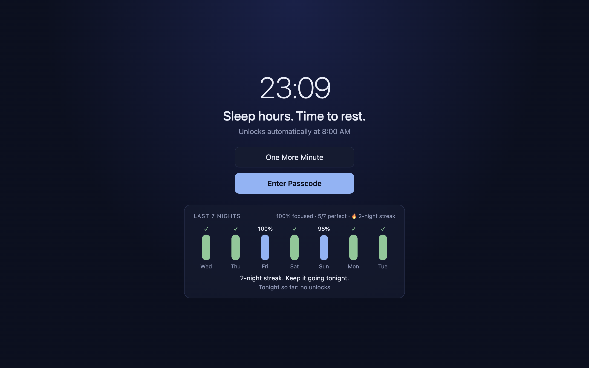
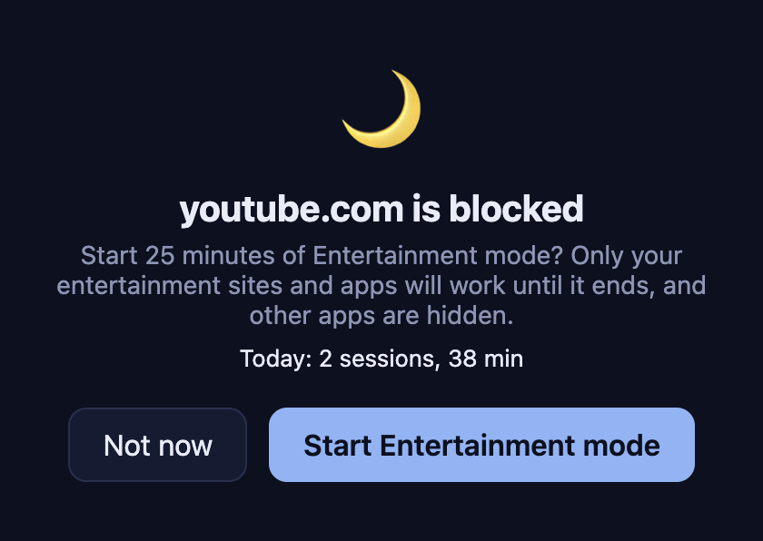
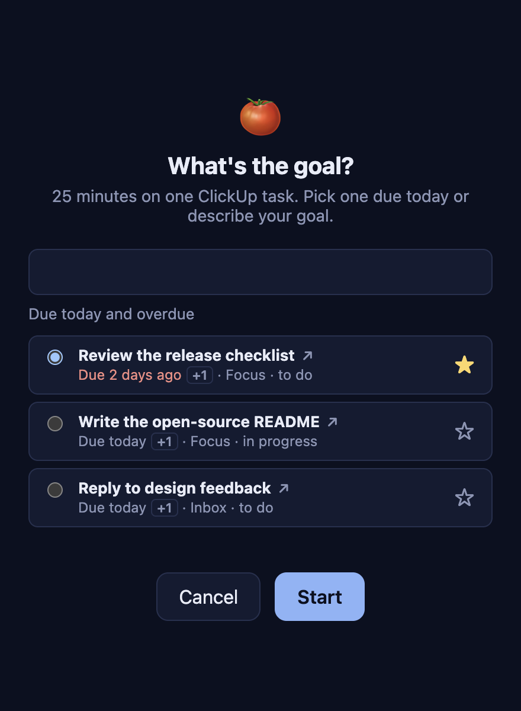
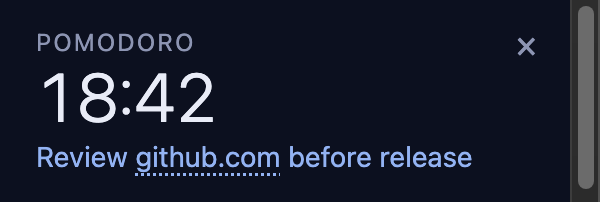
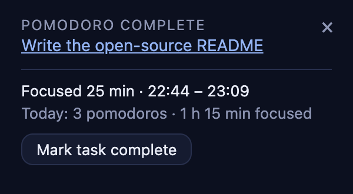
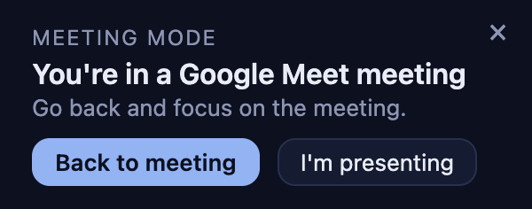
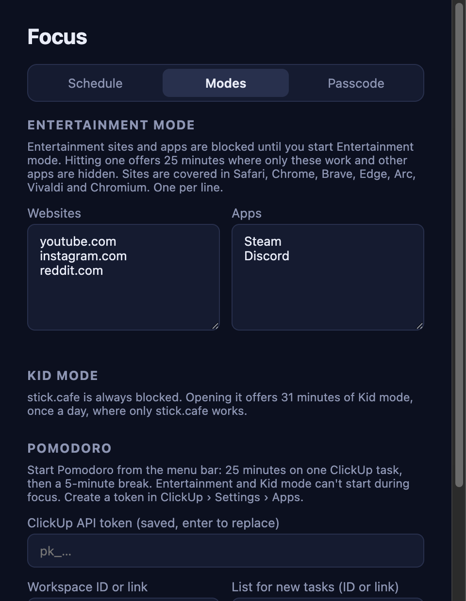
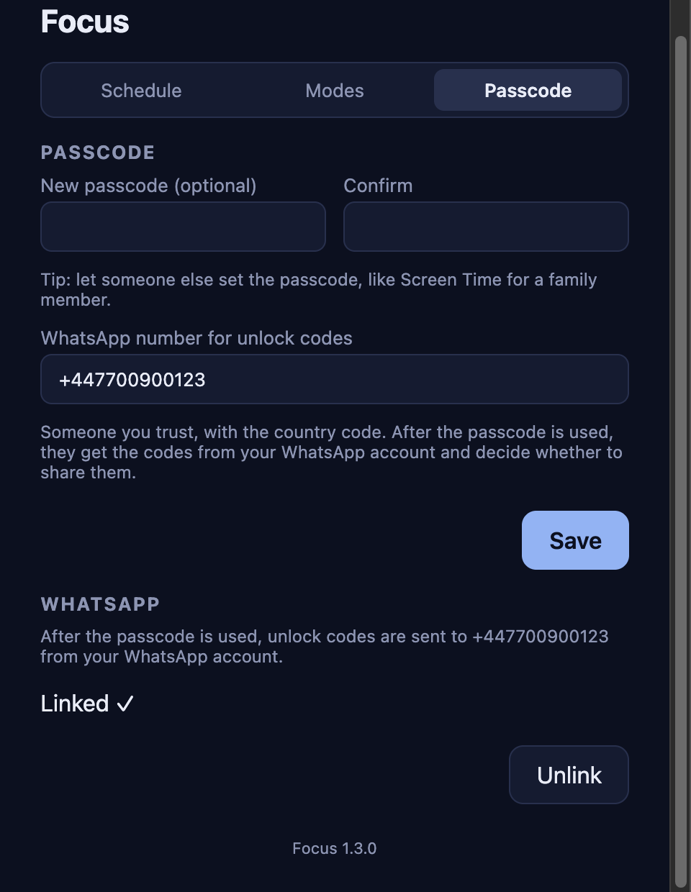

# Focus

A macOS menu-bar app that locks every screen during sleep hours (default 8 PM – 8 AM), modelled on Apple Screen Time.
It also blocks entertainment sites and apps around the clock, runs ClickUp-backed pomodoros and nudges you back into
meetings.



## Why

Screen Time is easy to dismiss on a Mac. Focus covers every display with a full-screen lock you can only get past in a
few deliberate ways, and keeps a nightly score so you can see how you're doing.

## Features

### Sleep-hours lock

- **One More Minute** — 1 minute of access, once per night.
- **Enter Passcode** — after a 30-second wait, a 4-digit passcode gives 15 minutes, then it locks again. Works once
  per night.
- **Ask via WhatsApp** — after the passcode is used, every further 15 minutes needs a 6-digit code sent over WhatsApp
  to someone you trust (set their number in Settings). Codes expire after 5 minutes and work once.
- **Lock Now** — done early? Pick it from the menu-bar icon to lock straight away.
- **Last 7 nights** — each night's focus score (share of sleep hours that stayed locked), a ✓ for perfect nights with
  no unlocks, your average and your current streak.

Five wrong passcodes lock the keypad for a minute. Settings and Quit are disabled during sleep hours, and outside them
Quit asks for the passcode.

### Entertainment mode



List entertainment websites and apps in Settings and they're blocked at all times. Tabs on a blocked site (or its
subdomains) switch to a "blocked" page in Safari, Chrome, Brave, Edge, Arc, Vivaldi and Chromium, and blocked apps are
quit as soon as they start. When you hit one, Focus offers 25 minutes of Entertainment mode: only your entertainment
sites and apps work, other pages switch to an "Entertainment mode" page and other apps are hidden. When it ends, tabs
go back to their pages and hidden apps reappear.

<br clear="right" />

### Kid mode

https://stick.cafe/ is always blocked; opening it offers 31 minutes of Kid mode, once per day, where only stick.cafe
works. End it early from the menu bar (it still counts as today's use).

### Pomodoro



**Start Pomodoro…** in the menu bar (or **⌥⌘P** from anywhere) opens on your ClickUp tasks due today and overdue. Pick one, or type a goal: Focus
searches the tasks assigned to you as you type and offers a new one (assigned to you, due today): **Create** just adds
it to ClickUp, **Create and start** also starts the pomodoro. The star on a task sets or clears its high priority in
ClickUp, and tasks are listed by priority. **+1** after a due date moves the task to tomorrow, and **↗** opens it in
the browser. You get 25 minutes of focus, then a 5-minute break. A
small always-on-top window shows the time left and, when it ends, a summary with **Mark task complete**.




<br clear="right" />

### Meeting mode



Turns on by itself while a Zoom meeting runs or a Google Meet room is open in a browser. Spend a minute in another app
or tab and a small reminder asks you to go back. Presenting? Tick **Presenting (pause reminders)** in the menu bar.

<br clear="right" />

While a mode, pomodoro or sleep-hours unlock is active, the menu bar shows a countdown next to the icon.

## Install

Focus is macOS only. Download the `.dmg` for your Mac from the
[latest release](https://github.com/rosinghal/focus/releases/latest): `arm64` for Apple silicon, `x64` for Intel.
Open it and drag Focus to Applications.

The app isn't signed or notarised, so macOS blocks it the first time. Open it once, then go to System Settings ›
Privacy & Security and click **Open Anyway**. If macOS says the app is damaged, clear the download flag:

```sh
xattr -dr com.apple.quarantine /Applications/Focus.app
```

It starts at login once installed.

### Build from source

```sh
git clone https://github.com/rosinghal/focus.git
cd focus
npm install
npm run install:local   # builds Focus.app, copies it to /Applications and launches it
```

`npm run dist` builds a `.dmg` in `dist/` instead.

## Setup

On first launch Settings opens on the **Passcode** tab. Blocking starts once a passcode is saved.

<p>
  
  
</p>

1. **Passcode** — for real accountability, let someone else set it.
2. **WhatsApp** (optional, but without it nothing unlocks once the passcode is used) — enter the number of the person
   who should get unlock codes, including the country code, and save. Then click **Link WhatsApp** and scan the QR code
   from WhatsApp › Settings › Linked Devices on your own phone. Codes are sent from your account and deleted on your
   side, so only the recipient can read them.
3. **Schedule** — sleep hours.
4. **Modes** — entertainment sites and apps, and a ClickUp personal API token (`pk_…`), workspace and list for
   Pomodoro (an ID or a link copied from ClickUp).
5. macOS asks once per browser to let Focus control it. Allow it, or that browser isn't covered.

Saving anything that only tightens blocking needs nothing. Loosening it — shorter sleep hours, unblocked sites or apps,
a new passcode or a new WhatsApp recipient — lists the changes and needs a WhatsApp code; the passcode works instead
only while WhatsApp isn't set up. Unlinking WhatsApp needs a code too.

## Privacy

Everything stays on your Mac, in `~/Library/Application Support/Focus`: settings, the scrypt-hashed passcode, the
focus log and the WhatsApp session. The ClickUp token is stored there in plain text and only sent to ClickUp. WhatsApp
codes are hashed and kept in memory only.

WhatsApp messages are sent with [Baileys](https://github.com/WhiskeySockets/Baileys), an unofficial WhatsApp Web
client, so WhatsApp could flag the account for automation.

## Limits

This is a self-control tool, not a security boundary. Killing the process from Terminal or Activity Monitor during an
unlock, changing the system clock, or using another user account will get around it. Firefox can't be scripted, so
block the Firefox app itself if needed.

## Development

```sh
npm install
npm start          # run in dev (locks the screen during sleep hours once a passcode is set)
npm test           # unit tests, once
```

Plain CommonJS, no build step. See [AGENTS.md](AGENTS.md) for the layout, conventions and behaviour that must hold, and
[CHANGELOG.md](CHANGELOG.md) for release history. To try it outside your own settings, launch with a throwaway
`--user-data-dir`. `FOCUS_WHATSAPP_DRY_RUN=1` prints WhatsApp codes instead of sending them.

## License

[MIT](LICENSE)
